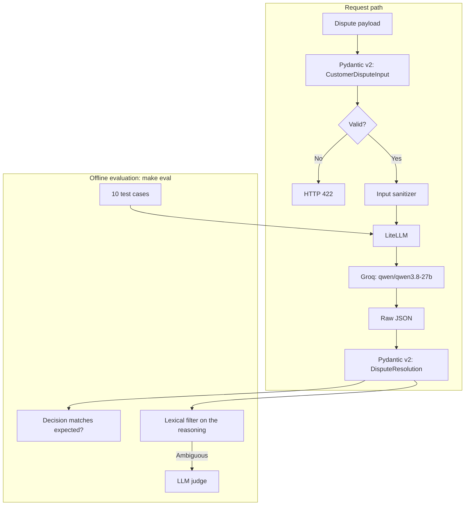

# DisputeGuard

An LLM-based service that resolves customer disputes for delivery and e-commerce platforms. Each dispute is sent to an LLM once, the response is forced into a typed decision (`REFUND`, `VOUCHER`, `REQUEST_INFO` or `ESCALATE`), and a separate evaluation suite checks the decisions against expected outcomes.

[](https://github.com/kaioken13/disputeguard/actions/workflows/ci.yml)
[](https://www.python.org/)
[](https://docs.pydantic.dev/)
[](https://docs.litellm.ai/)
[](https://groq.com/)
[](LICENSE)

<!-- TODO: confirm the repository path in the CI badge. A real Actions badge replaces the static "Passing" one, which never changes. -->

## Overview

Delivery platforms receive disputes that look alike: late orders, missing items, spilled food, "delivered" orders the customer never received. Most follow a policy, but some need a human, especially when fraud is possible.

DisputeGuard takes a `CustomerDisputeInput`, asks the model for a decision based on a written policy, and returns a validated `DisputeResolution`. Outputs that do not match the schema are rejected instead of being passed on.

Scope, stated plainly:

- One LLM call per dispute. There are no tools or multi-step loops.
- The decision set is `REFUND`, `VOUCHER`, `REQUEST_INFO`, `ESCALATE`. There is no outright denial.
- The evaluation suite runs offline with `make eval`. It is not part of the request path.

## Architecture



<!-- TODO: confirm that the audit (lexical filter + judge) only runs in evaluate.py and not in the request path. -->

## How it works

- **Typed output.** The model is asked for JSON and the result is parsed with `DisputeResolution.model_validate_json()`. A response that does not fit the schema raises an error instead of reaching the caller.
- **Provider setup through LiteLLM.** The model is a configuration string (`qwen/qwen3.8-27b` on Groq today). Changing providers means changing that string and the API key.
- **Concurrency limit and retries.** An `asyncio.Semaphore` caps concurrent calls, and failed calls are retried with exponential backoff to stay within the provider's tokens-per-minute and requests-per-minute limits.
- **Input sanitization.** Incoming text is cleaned before it reaches the prompt. This lowers risk but does not eliminate prompt injection (see Limitations).

## API

<!-- TODO: confirm main.py (FastAPI) is in the repository, then keep this section and add it to the project structure. -->

| Method | Path | Description |
| --- | --- | --- |
| `GET` | `/health` | Liveness check. Returns `{"status": "healthy", "service": "disputeguard"}`. |
| `POST` | `/api/v1/dispute/resolve` | Body: `CustomerDisputeInput`. Returns a `DisputeResolution`. |

Invalid bodies return `422`. Unexpected errors return `500`. Interactive docs are served at `/docs`.

Run locally:

```bash
uvicorn main:app --reload
```

## Evaluation

### Method

`evaluate.py` runs 10 hand-written disputes concurrently and compares each decision with the expected one. The reasoning text returned by the model is then audited in two tiers: a bilingual (Portuguese and English) regex filter, and an LLM judge for the cases the filter cannot settle.

<!-- TODO: state which model acts as judge and what it scores (for example, whether the reasoning is consistent with the decision and the policy). If the judge is the same model as the agent, say so. -->

### Results (single run)

All 10 decisions matched the expected ones, and all 10 responses parsed into `DisputeResolution`.

| Case | Scenario | Decision | Latency (ms) | Policy |
| --- | --- | --- | ---: | --- |
| TC-01 | Severe delay (>60 min) without delivery | `REFUND` | 2,294 | Logistics threshold breach |
| TC-02 | Claim that the whole package never arrived | `ESCALATE` | 639 | Human audit, anti-fraud |
| TC-03 | Minor delay within tolerance (<5 min) | `REQUEST_INFO` | 763 | Claim under the tolerance window |
| TC-04 | One secondary item missing (for example, a drink) | `VOUCHER` | 963 | Partial remediation |
| TC-05 | Restaurant could not fulfil the order (stockout) | `REFUND` | 1,334 | Merchant cancellation |
| TC-06 | Spill or condiment leakage | `VOUCHER` | 2,585 | Quality goodwill credit |
| TC-07 | Marked delivered by GPS, customer says not received | `ESCALATE` | 4,917 | Telemetry and driver log audit |
| TC-08 | Wrong order or broken seal | `ESCALATE` | 5,042 | Food safety and packaging check |
| TC-09 | Repeated abusive claims by the same customer | `ESCALATE` | 1,335 | Account supervisor review |
| TC-10 | Vague complaint | `REQUEST_INFO` | 4,969 | Ask for evidence |

| Metric | Value |
| --- | --- |
| Decision accuracy | 10/10 |
| Schema-valid responses | 10/10 |
| Refunds issued on the 4 cases expected to escalate | 0 |
| Latency, median | ~1.8 s |
| Latency, mean | ~2.5 s |
| Latency, min / max | 0.64 s / 5.04 s |

Latency figures are computed from the per-case values above. Cases run concurrently under the concurrency limit, so a latency can include waiting and retry backoff, not only model time.

<details>
<summary>Raw per-case output</summary>

```text
[PASS] TC-01 | Latência: 2294.04ms | Decisão Esperada: REFUND       | Obtida: REFUND
[PASS] TC-02 | Latência:  638.89ms | Decisão Esperada: ESCALATE     | Obtida: ESCALATE
[PASS] TC-03 | Latência:  762.92ms | Decisão Esperada: REQUEST_INFO | Obtida: REQUEST_INFO
[PASS] TC-04 | Latência:  962.86ms | Decisão Esperada: VOUCHER      | Obtida: VOUCHER
[PASS] TC-05 | Latência: 1334.17ms | Decisão Esperada: REFUND       | Obtida: REFUND
[PASS] TC-06 | Latência: 2584.69ms | Decisão Esperada: VOUCHER      | Obtida: VOUCHER
[PASS] TC-07 | Latência: 4917.39ms | Decisão Esperada: ESCALATE     | Obtida: ESCALATE
[PASS] TC-08 | Latência: 5041.92ms | Decisão Esperada: ESCALATE     | Obtida: ESCALATE
[PASS] TC-09 | Latência: 1334.80ms | Decisão Esperada: ESCALATE     | Obtida: ESCALATE
[PASS] TC-10 | Latência: 4968.87ms | Decisão Esperada: REQUEST_INFO | Obtida: REQUEST_INFO
```

</details>

### How to read these results

- The test cases and expected decisions were written by the author, and the prompt was developed against them. 10/10 shows the service handles these cases, not that it will on real disputes.
- Ten synthetic cases are too few to estimate an error rate. One run says nothing about variance between runs.
- Several cases rest on the policy, not on facts the model could verify (for example, whether the GPS log is right). The model decides from the text it is given.

## Limitations

- **Prompt injection.** Customer text is untrusted input to a model that can authorize refunds. Sanitization reduces the risk but cannot remove it. Constrained output and the `ESCALATE` path are the main mitigations.
- **No denial outcome.** A claim that should be rejected ends up as `REQUEST_INFO` or `ESCALATE`.
- **No human review loop, authentication or audit trail** in the service itself.
- **No monetary limits or business rules outside the prompt.** The policy lives in the prompt and is not enforced by code.
- **Evaluation scope.** Small, synthetic, single-run and self-authored (see above).

## Tech stack

| Area | Tool |
| --- | --- |
| Runtime | Python 3.11+ |
| Validation | [Pydantic v2](https://github.com/pydantic/pydantic) |
| LLM gateway | [LiteLLM](https://github.com/BerriAI/litellm) |
| Inference | [Groq](https://groq.com) (`qwen/qwen3.8-27b`) |
| Lint and format | [Ruff](https://github.com/astral-sh/ruff) |
| Typing | [Mypy](https://github.com/python/mypy) (strict) |
| Tests | [Pytest](https://docs.pytest.org/) |

<!-- TODO: list the Python versions your CI matrix actually runs. Remove any version that CI does not test. -->

## Project structure

```text
disputeguard/
├── .github/workflows/ci.yml   # Lint, type check, unit tests
├── src/
│   ├── __init__.py
│   ├── agent.py               # Prompt and resolve_dispute()
│   └── schemas.py             # CustomerDisputeInput, DisputeResolution
├── tests/
│   ├── __init__.py
│   └── test_agent.py          # Offline tests with mocked LLM responses
├── .env.example
├── evaluate.py                # Concurrent evaluation suite
├── Makefile
├── pyproject.toml
└── README.md
```

## Quickstart

Requirements: Python 3.11+ and [uv](https://github.com/astral-sh/uv) (or `pip`).

```bash
git clone https://github.com/kaioken13/disputeguard.git
cd disputeguard

uv venv
source .venv/bin/activate        # Windows: .venv\Scripts\activate
uv pip install -e ".[dev]"

cp .env.example .env             # then set GROQ_API_KEY in .env
```

## Development

```bash
make lint     # Ruff checks
make format   # Ruff formatting
make test     # Offline unit tests (mocked LLM)
make eval     # Concurrent evaluation, calls the real API
```

CI runs lint, type checks and the mocked unit tests only. It does not call the model, so `make eval` is run manually.

## Security

- No credentials are committed. API keys live in `.env`, which is git-ignored.
- CI uses mocked responses, so builds never use a production key.
- See Limitations for what input sanitization does and does not protect against.

## License

MIT. See [LICENSE](LICENSE).
