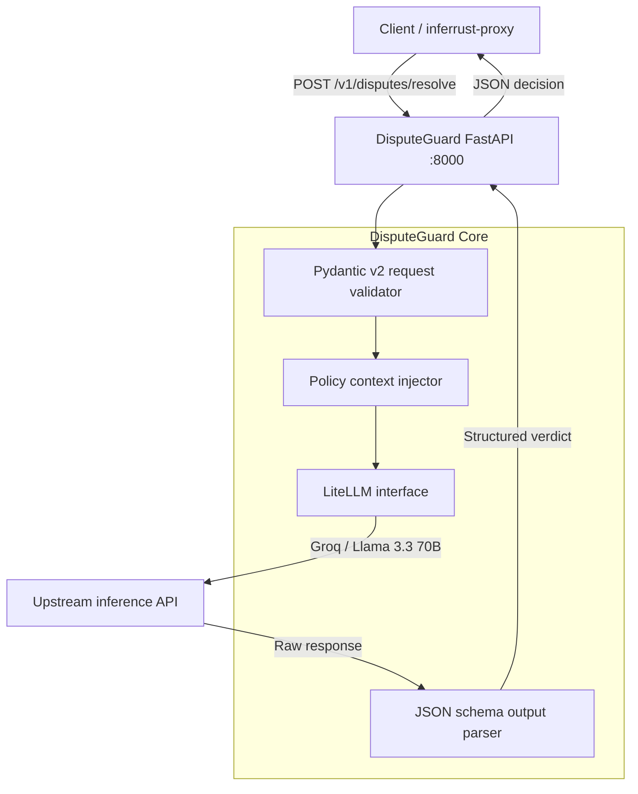

# DisputeGuard 🛡️

An asynchronous dispute-resolution decision service built with **Python**, **FastAPI** and **Pydantic v2**, driven by **LiteLLM**. It triages customer disputes for delivery platforms into `REFUND`, `VOUCHER`, `REQUEST_INFO` or `ESCALATE`, rejects any model output that does not match a typed schema, and ships with an offline evaluation suite.

[](https://www.python.org/)
[](https://fastapi.tiangolo.com/)
[](https://docs.pydantic.dev/)
[](https://docs.litellm.ai/)
[](https://groq.com/)
[](Dockerfile)
[](LICENSE)

**Contents:** [Core features](#core-features) · [Architecture](#architecture) · [Decision taxonomy](#decision-taxonomy) · [Quickstart](#quickstart) · [API reference](#api-reference) · [Evaluation](#evaluation) · [Integration with inferrust-proxy](#integration-with-inferrust-proxy) · [Limitations](#limitations)

---

## Core features

- **Typed output (Pydantic v2).** Responses must match a structured model (`decision`, `confidence_score`, `reasoning`). Output that does not match is rejected. Validation guarantees the *format* of the answer, not that the decision is correct.
- **Policy in the prompt.** The system prompt carries explicit business rules, for example refunds for delivery delays above 45 minutes, vouchers for minor issues, and escalation for suspected fraud.
- **Provider setup through LiteLLM.** The model is set with `MODEL_NAME`. Evaluation results exist only for Groq `llama-3.3-70b-versatile`; other providers are not evaluated.
- **Retries on rate limits.** Calls are asynchronous. On HTTP 429 they are retried with incremental backoff (4 s, 8 s and 12 s in the evaluation run).
- **Offline evaluation.** `make eval` runs 10 hand-written dispute scenarios against expected decisions.

---

## Architecture



---

## Decision taxonomy

| Verdict | Trigger criteria |
| :--- | :--- |
| `REFUND` | Delivery delay above 45 min, wrong or missing items, or ruined orders. |
| `VOUCHER` | Minor delivery delays (15 to 30 min), slight packaging defects, cold meals without damage. |
| `REQUEST_INFO` | Insufficient description or ambiguous claims. |
| `ESCALATE` | Suspected fraud or abuse, or safety issues. |

The request carries only `order_id`, `customer_id` and `dispute_text`. Criteria are evaluated from the text of the claim: the service has no order history, photos or logistics data to verify it.

---

## Quickstart

### 1. Environment

Create a `.env` file in the project root:

```bash
GROQ_API_KEY="your-groq-api-key"
MODEL_NAME="groq/llama-3.3-70b-versatile"
ENVIRONMENT="production"
PORT=8000
```

### 2. Docker

```bash
docker build -t disputeguard-api .
docker run -d --name disputeguard -p 8000:8000 --env-file .env disputeguard-api
```

### 3. Native Python

```bash
uv venv
source .venv/bin/activate        # Windows: .venv\Scripts\activate
uv pip install -e ".[dev]"

uvicorn src.main:app --host 0.0.0.0 --port 8000 --reload
```

Interactive docs are served at `http://localhost:8000/docs`.

---

## API reference

### Resolve a dispute

`POST /v1/disputes/resolve`

Request:

```json
{
  "order_id": "ORD-2024-8841",
  "customer_id": "CUST-9921",
  "dispute_text": "My meal arrived over 70 minutes late and was completely cold."
}
```

Example response (`200 OK`):

```json
{
  "decision": "REFUND",
  "confidence_score": 0.85,
  "reasoning": "Customer reported delivery delay exceeding 70 minutes, which surpasses the 45-minute platform SLA threshold for automatic full refunds. The complaint satisfies logistical breach criteria."
}
```

---

## Evaluation

### Method

`make eval` sends 10 hand-written dispute scenarios to the service and compares each decision with the expected one, using `groq/llama-3.3-70b-versatile`. The reasoning text is then audited in two tiers: a bilingual (Portuguese and English) regex filter, and an LLM judge for the cases the filter cannot settle.

### Report

```text
======================================================================
CONCURRENT BENCHMARK: DISPUTEGUARD (LLM-AS-A-JUDGE)
======================================================================
[PASS] TC-01 | Latency: 1602.95ms | Expected: REFUND       | Obtained: REFUND
[PASS] TC-02 | Latency: 627.47ms  | Expected: ESCALATE     | Obtained: ESCALATE
[PASS] TC-03 | Latency: 5259.37ms | Expected: REQUEST_INFO | Obtained: REQUEST_INFO
[PASS] TC-04 | Latency: 12876.09ms| Expected: VOUCHER      | Obtained: VOUCHER
[PASS] TC-05 | Latency: 12841.81ms| Expected: REFUND       | Obtained: REFUND
[PASS] TC-06 | Latency: 658.09ms  | Expected: VOUCHER      | Obtained: VOUCHER
[PASS] TC-07 | Latency: 25038.61ms| Expected: ESCALATE     | Obtained: ESCALATE
[PASS] TC-08 | Latency: 4715.74ms | Expected: ESCALATE     | Obtained: ESCALATE
[PASS] TC-09 | Latency: 4833.15ms | Expected: ESCALATE     | Obtained: ESCALATE
[PASS] TC-10 | Latency: 4926.85ms | Expected: REQUEST_INFO | Obtained: REQUEST_INFO
----------------------------------------------------------------------
CONSOLIDATED METRICS:
  Global Accuracy:       100.0% (10/10)
  Nominal Latency:       627 ms - 1602 ms (Unthrottled)
  Mean Batch Latency:    7338.01 ms
  P95 Latency:           25038.61 ms (With backoff retries)
  Total Batch Time:      73.38 s
======================================================================
```

### How to read these results

- The 10 cases and their expected decisions were written by the author, and the prompt was developed against them. 10/10 shows the service handles these scenarios, not that it will on real disputes. This is a single run.
- Latencies include retries after HTTP 429. Three cases (TC-02, TC-06 and TC-01, between 627 and 1,603 ms) ran without hitting the provider's limit. TC-04, TC-05 and TC-07 were retried several times. The 4.7 to 5.3 s cases (TC-03, TC-08, TC-09, TC-10) are also consistent with one retry. The mean (7.3 s) therefore reflects the provider's rate limit as much as the service.
- With 10 samples, the 95th percentile is the maximum value (25.04 s).
- "Total Batch Time" (73.38 s) equals the sum of the 10 per-case latencies.
- This benchmark calls the model provider directly. It did not go through `inferrust-proxy`.

---

## Integration with inferrust-proxy

[inferrust-proxy](https://github.com/kaioken13/inferrust-proxy) can sit in front of DisputeGuard on port `3000`. The setup (clone both repositories side by side, export `GROQ_API_KEY`, start `docker-compose.integration.yml`) is described in the proxy README.

```bash
# Through the proxy: Cache MISS on the first call, HIT on a repeat with the same key
curl -i -X POST http://localhost:3000/v1/disputes/resolve \
  -H "Content-Type: application/json" \
  -H "Idempotency-Key: ifood-claim-991" \
  -d '{
    "order_id": "ORD-991",
    "customer_id": "CUST-10",
    "dispute_text": "Item missing from the package."
  }'
```

- **Cache MISS:** the request goes to DisputeGuard and the response is stored in Redis for 24 hours.
- **Cache HIT:** the proxy answers from Redis in under 5 ms without calling DisputeGuard.

**What the proxy helps with:** a client that retries with the same `Idempotency-Key` gets the stored decision instead of a second LLM call.

**What it does not help with:** distinct disputes arriving in a burst still reach the model and can still hit the provider's rate limit. The proxy also matches only on the key, not on the request body (see the proxy's limitations).

---

## Limitations

- **Prompt injection.** Customer text is untrusted input to a model that influences refunds. Schema validation and the `ESCALATE` path are the main defenses.
- **Claims cannot be verified.** The service decides from the customer's description. It has no access to order data, logistics logs or photos.
- **No outright rejection.** A claim that should be denied ends up as `REQUEST_INFO` or `ESCALATE`.
- **No human review loop** is included. The output is a policy recommendation, and refund authorization should stay with the downstream ledger.
- **Small evaluation.** Ten author-written scenarios, one run, one model.

---

## 👨‍💻 Author

**Thiago Aragão da Silva**<br/>
Data Science undergraduate at University of São Paulo (ICMC-USP)<br/>
Focus: Systems Engineering, MLOps & High-Performance AI Gateways<br/>
[GitHub](https://github.com/kaioken13) · [LinkedIn](https://www.linkedin.com/in/thiagoaragao147/)

## 📜 License

MIT License. See [LICENSE](LICENSE) for details.
