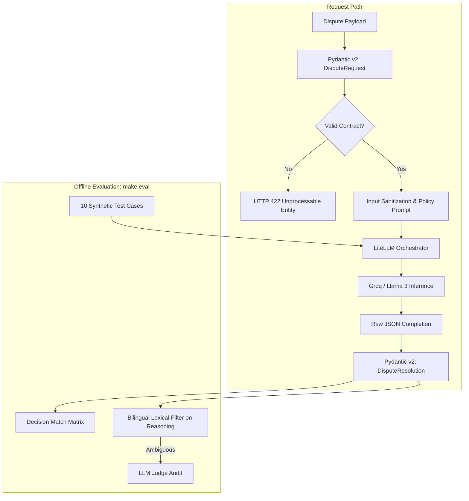
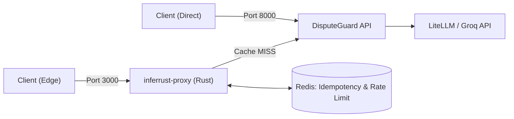

# DisputeGuard 🛡️

An LLM-based decision service that resolves customer order disputes for delivery and e-commerce platforms. Each dispute is validated via Pydantic v2, evaluated against structured operational policies using an LLM, forced into a typed decision (`REFUND`, `VOUCHER`, `REQUEST_INFO`, or `ESCALATE`), and verified by an offline evaluation suite.

[](https://github.com/kaioken13/disputeguard/actions/workflows/ci.yml)
[](https://www.python.org/)
[](https://fastapi.tiangolo.com/)
[](https://docs.pydantic.dev/)
[](https://docs.litellm.ai/)
[](https://groq.com/)
[](Dockerfile)
[](LICENSE)

**Contents:** [Overview](#overview) · [Architecture](#architecture) · [API Endpoints](#api-endpoints) · [Running behind inferrust-proxy](#running-behind-inferrust-proxy) · [Evaluation](#evaluation) · [Limitations](#limitations) · [Project Structure](#project-structure) · [Quickstart](#quickstart) · [Development](#development)

---

## Overview

Delivery platforms receive recurring customer disputes: late arrivals, missing items, damaged food, or unreceived drop-offs. Most cases adhere to business policies, but high-risk or ambiguous claims require human review to prevent fraud.

DisputeGuard takes a typed dispute request, queries a reasoning model configured with decision policies, and returns a strictly validated resolution schema. Any model output deviating from the defined schema is rejected at runtime.

Scope, stated plainly:
- **Single-shot inference:** One LLM call per dispute (no autonomous agentic loops or unbounded tool calls).
- **Constrained outcomes:** Output domain restricted to `REFUND`, `VOUCHER`, `REQUEST_INFO`, and `ESCALATE`. There is no outright programmatic rejection.
- **Offline evaluation:** Benchmarking suite executed independently via `make eval`.
- **Deployment options:** Runs standalone on port `8000`, or as a protected downstream service behind [inferrust-proxy](https://github.com/kaioken13/inferrust-proxy) on port `3000` (which provides Redis-backed distributed idempotency and rate limiting).

---

## Architecture



---

## How it works

- **Typed Output:** The model is constrained to JSON, validated at runtime with Pydantic v2 (`DisputeResolution.model_validate_json()`). Invalid outputs raise validation errors rather than returning broken state.
- **Provider Abstraction with LiteLLM:** Model orchestration is decoupled from the underlying provider. Switching from Groq to an internal inference cluster requires updating environment configuration without touching domain logic.
- **Concurrency Control & Retries:** `asyncio.Semaphore` guards against upstream rate limits, handling transient provider backoff gracefully.
- **Input Sanitization:** Customer-submitted text undergoes sanitization prior to template interpolation to mitigate injection risks.

---

## API Endpoints

| Method | Path | Description |
| :--- | :--- | :--- |
| `GET` | `/health` | Liveness probe. Returns `{"status": "ok", "project": "disputeguard"}`. |
| `POST` | `/v1/disputes/resolve` | Evaluates dispute text and returns a typed resolution decision. |

Interactive OpenAPI documentation is served at `/docs`.

---

## Running behind inferrust-proxy

DisputeGuard provides two deployment topologies:

| Port | Request Flow | Operational Guarantees |
| :---: | :--- | :--- |
| **`8000`** | `Client -> DisputeGuard` | Direct API access. Every request triggers downstream LLM inference. |
| **`3000`** | `Client -> inferrust-proxy -> DisputeGuard` | Edge gateway protection: Redis-backed distributed idempotency (`Idempotency-Key` header) and token-aware rate limiting. |



### End-to-End Execution Example

#### 1. Direct Call (Port 8000 - Always runs inference)
```bash
curl -i -X POST http://localhost:8000/v1/disputes/resolve \
  -H "Content-Type: application/json" \
  -d '{
    "order_id": "ORD-SMOKE-1",
    "customer_id": "CUST-001",
    "dispute_text": "Pedido atrasou mais de 1 hora e a embalagem veio rasgada.",
    "order_amount": 55.00
  }'
```

#### 2. Via Edge Proxy (Port 3000 - Idempotent & Cached)
```bash
# First request: Cache MISS (~800ms)
curl -i -X POST http://localhost:3000/v1/disputes/resolve \
  -H "Content-Type: application/json" \
  -H "Idempotency-Key: ifood-smoke-001" \
  -d '{
    "order_id": "ORD-SMOKE-1",
    "customer_id": "CUST-001",
    "dispute_text": "Pedido atrasou mais de 1 hora e a embalagem veio rasgada.",
    "order_amount": 55.00
  }'

# Second request with identical key: Cache HIT (<4ms, served from Redis)
curl -i -X POST http://localhost:3000/v1/disputes/resolve \
  -H "Content-Type: application/json" \
  -H "Idempotency-Key: ifood-smoke-001" \
  -d '{
    "order_id": "ORD-SMOKE-1",
    "customer_id": "CUST-001",
    "dispute_text": "Pedido atrasou mais de 1 hora e a embalagem veio rasgada.",
    "order_amount": 55.00
  }'
```

#### Actual JSON Response Payload (`200 OK`)
```json
{
  "decision": "ESCALATE",
  "confidence_score": 0.6,
  "reasoning": "Não há dados transacionais disponíveis para confirmar o atraso superior a 45 minutos ou falha logística. Sem evidência comprovada, a política exige REFUND apenas quando o atraso é comprovado. Assim, a decisão mais prudente é escalar a reclamação para investigação adicional."
}
```

### Why Place a Proxy at the Edge?
- **Safe Network Retries:** Mobile clients retrying on network drops receive the original decision without triggering duplicate LLM inferences or double refund calculations.
- **Deterministic Outcomes:** LLM outputs can vary across identical calls. Storing the verified decision under the client's `Idempotency-Key` stabilizes the response for 24 hours.
- **Cost & Latency Reduction:** Repeated claims or duplicate triggers are answered sub-5ms from Redis, skipping external GPU compute costs.

---

## Evaluation

### Method
`evaluate.py` runs 10 synthetic real-world delivery dispute cases concurrently. Decisions are verified against baseline expectations, and returned reasoning text is audited using a two-tier filter: bilingual regex matching followed by an LLM-as-a-judge review on edge cases.

### Results (Sample Run)

All 10 decisions matched expected outcomes, parsing strictly into `DisputeResolution`.

| Case | Scenario | Decision | Latency (ms) | Policy Applied |
| :---: | :--- | :---: | ---: | :--- |
| **TC-01** | Severe delay (>60 min) without delivery | `REFUND` | 2,294 | Logistics threshold breach |
| **TC-02** | Claim that the whole package never arrived | `ESCALATE` | 639 | Anti-fraud audit |
| **TC-03** | Minor delay within tolerance (<5 min) | `REQUEST_INFO` | 763 | Under tolerance threshold |
| **TC-04** | Single secondary item missing (e.g., drink) | `VOUCHER` | 963 | Partial remediation credit |
| **TC-05** | Merchant stockout cancellation | `REFUND` | 1,334 | Merchant-side cancellation |
| **TC-06** | Condiment spill or packaging leakage | `VOUCHER` | 2,585 | Quality goodwill credit |
| **TC-07** | Marked delivered by GPS, customer denies | `ESCALATE` | 4,917 | Telemetry & driver log audit |
| **TC-08** | Tampered seal / wrong order delivered | `ESCALATE` | 5,042 | Food safety inspection |
| **TC-09** | Abusive claim history on customer profile | `ESCALATE` | 1,335 | Account supervisor review |
| **TC-10** | Unsubstantiated complaint | `REQUEST_INFO` | 4,969 | Request additional evidence |

| Metric | Measured Value |
| :--- | :--- |
| **Decision Accuracy** | 10 / 10 |
| **Schema-Valid Outputs** | 10 / 10 |
| **Erroneous Refunds on Escalation Cases** | 0 |
| **Median Latency** | ~1.8 s |
| **Mean Latency** | ~2.5 s |
| **Latency Min / Max** | 0.64 s / 5.04 s |

<details>
<summary>Raw per-case evaluation output</summary>

```text
[PASS] TC-01 | Latência: 2294.04ms | Decisão Esperada: REFUND       | Obtida: REFUND
[PASS] TC-02 | Latência:  638.89ms | Decisão Esperada: ESCALATE     | Obtida: ESCALATE
[PASS] TC-03 | Latência:  762.92ms | Decisão Esperada: REQUEST_INFO | Obtida: REQUEST_INFO
[PASS] TC-04 | Latência:  962.86ms | Decisão Esperada: VOUCHER      | Obtida: VOUCHER
[PASS] TC-05 | Latência: 1334.17ms | Decisão Esperada: REFUND       | Obtida: REFUND
[PASS] TC-06 | Latência: 2584.69ms | Decisão Esperada: VOUCHER      | Obtida: VOUCHER
[PASS] TC-07 | Latência: 4917.39ms | Decisão Esperada: ESCALATE     | Obtida: ESCALATE
[PASS] TC-08 | Latência: 5041.92ms | Decisão Esperada: ESCALATE     | Obtida: ESCALATE
[PASS] TC-09 | Latência: 1334.80ms | Decisão Esperada: ESCALATE     | Obtida: ESCALATE
[PASS] TC-10 | Latência: 4968.87ms | Decisão Esperada: REQUEST_INFO | Obtida: REQUEST_INFO
```

</details>

---

## Limitations

- **Prompt Injection:** Customer text is untrusted input. Regex sanitization lowers risk, but strict schema enforcement and escalation pathways remain the primary safeguards.
- **No Direct Rejection:** Claims that fail policy requirements resolve to `REQUEST_INFO` or `ESCALATE` rather than outright programmatic rejection.
- **Policy Storage:** Decision thresholds currently reside within the prompt template rather than an external dynamic rules engine.
- **Evaluation Bounds:** 10 curated synthetic test cases validate core policy adherence, but real-world variance requires continuous evaluation over production distributions.

---

## Project Structure

```text
disputeguard/
├── .github/workflows/ci.yml   # Lint, type check, unit tests
├── src/
│   ├── __init__.py
│   ├── config.py              # Application settings and environment loading
│   ├── main.py                # FastAPI entrypoint (/health, /v1/disputes/resolve)
│   ├── pipeline.py            # Orchestration flow, sanitization, LiteLLM bridge
│   └── schemas.py             # DisputeRequest, DisputeResolution Pydantic schemas
├── tests/
│   ├── __init__.py
│   └── test_pipeline.py       # Offline unit tests with mocked LLM responses
├── .env.example
├── evaluate.py                # Concurrent evaluation benchmark
├── Dockerfile
├── Makefile
├── pyproject.toml
└── README.md
```

---

## Quickstart

### Prerequisites
- Docker & Docker Compose (v2)
- Groq API Key (`GROQ_API_KEY`)
- Python 3.11+ and `uv` (for local development)

### Option A: Integrated Stack via Docker Compose (Recommended)

Orchestrates DisputeGuard alongside `inferrust-proxy` and Redis on `ml-infra-net`:

```bash
# From the inferrust-proxy sibling directory:
cd ../inferrust-proxy
docker compose -f docker-compose.integration.yml up --build -d
```

### Option B: Local Development (Bare Metal)

```bash
git clone https://github.com/kaioken13/disputeguard.git
cd disputeguard

# Virtual environment setup
uv venv
source .venv/bin/activate    # Windows: .venv\Scripts\activate
uv pip install -e ".[dev]"

# Configure environment
cp .env.example .env
# Set GROQ_API_KEY inside .env

# Run FastAPI service
uvicorn src.main:app --reload --port 8000
```

Verify service status:
```bash
curl http://localhost:8000/health
```

---

## Development

```bash
make lint     # Run Ruff linter
make format   # Run Ruff formatting
make test     # Offline unit tests with mocked LLM fixtures
make eval     # Run concurrent evaluation against live model
```

CI runs linting, static type checking, and mocked unit tests on every pull request without requiring external API keys.

---

## 👨‍💻 Author

**Thiago Aragão da Silva**  
Data Science undergraduate at University of São Paulo (ICMC-USP)  
Focus: Systems Engineering, MLOps & High-Performance AI Gateways  
[GitHub](https://github.com/kaioken13) · [LinkedIn](https://www.linkedin.com/in/thiagoaragao147/)

---

## 📜 License

MIT License. See [LICENSE](LICENSE) for details.
